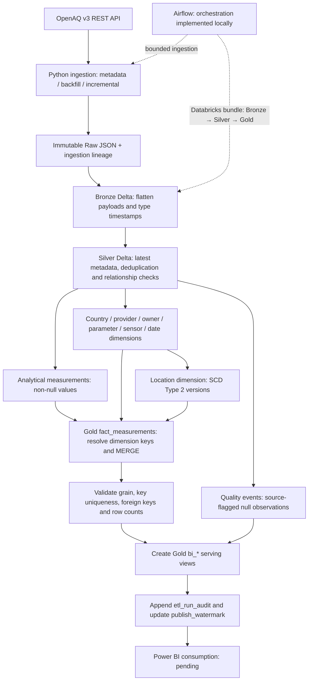
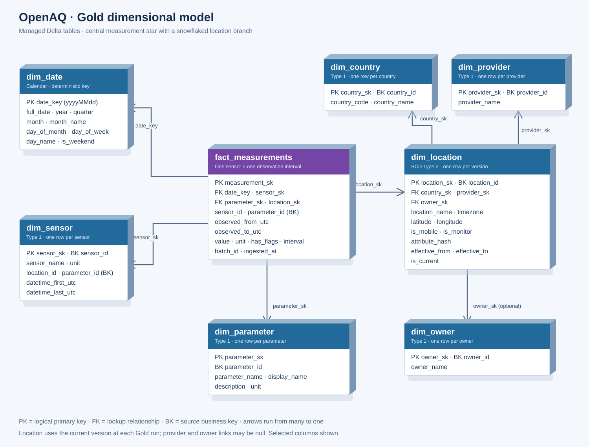

# OpenAQ Air Quality Lakehouse

An API-first Azure lakehouse for historical and incremental air-quality measurements.

## Data flow

OpenAQ v3 REST API → Python ingestion → immutable Raw JSON in ADLS Gen2 →
Databricks Bronze Delta → Silver Delta → Gold dimensions/facts → Power BI.

Status: the full 03→04→05 medallion chain (including the Gold fact table) ran green twice
with identical results on 2026-10-25 and is packaged as a Databricks Asset Bundle
(`databricks.yml`, job `openaq_medallion_pipeline`) — bundle validated, job execution
currently blocked by the workspace org state. Airflow orchestration and CI validation are
implemented locally; downstream serving and cloud Airflow execution remain pending.
CI is 2/3 green; Bundle validation is explicitly platform-blocked by the Free Edition org API gate.

## End-to-end architecture



Raw is an immutable JSON landing boundary; Bronze, Silver and Gold are managed
Unity Catalog Delta tables (default catalog: `workspace`). The documented Free
Edition path stages files in `./landing`, uploads them through Catalog UI, then
uses notebook 06 to copy them into `/Volumes/workspace/raw/openaq_landing`.
The ingestion writer also supports ADLS. Airflow coordinates ingestion and the
Databricks medallion job; cloud execution and downstream serving remain pending.

## Gold dimensional model

The central star has **one measurement fact and four directly linked dimensions**.
Location extends into country, provider and owner, making the implemented model a
**star with a snowflaked location branch**. The raised table cards below give a
3D-style view of the actual schema; arrows follow foreign-key lookups from many
rows to one dimension row.



[Open the full-size model](docs/images/gold-star-schema.svg).

**Fact grain:** one row per `(sensor_id, observed_from_utc, observed_to_utc)`.
`measurement_sk` is the identity surrogate key. The fact stores `value`, `unit`,
`has_flags`, `interval`, both UTC observation timestamps, source `sensor_id` and
`parameter_id`, plus `batch_id` and `ingested_at` for lineage. Values must be
interpreted with their parameter and unit; summing across pollutants or units
is not meaningful.

| Dimension | Key referenced by | Purpose and update strategy |
|---|---|---|
| `dim_date` | Fact `date_key` → `date_key` | UTC observation-start date; deterministic `yyyyMMdd` key, calendar attributes, insert-only MERGE |
| `dim_sensor` | Fact `sensor_sk` → `sensor_sk` | Sensor identity and coverage; Type 1 updates retain the surrogate key |
| `dim_parameter` | Fact `parameter_sk` → `parameter_sk` | Pollutant/parameter definition and unit; Type 1 |
| `dim_location` | Fact `location_sk` → `location_sk` | Coordinates, timezone and monitoring attributes; SCD Type 2 |
| `dim_country` | Location `country_sk` → `country_sk` | Country code and name; Type 1 |
| `dim_provider` | Location `provider_sk` → `provider_sk` | Data provider; optional relationship, Type 1 |
| `dim_owner` | Location `owner_sk` → `owner_sk` | Monitoring owner; optional relationship, Type 1 |

`*_sk` keys are Delta-generated identity keys; `date_key` is derived from the
calendar date. Source business keys (`*_id`) remain available for traceability.
The sensor dimension retains `location_id` and `parameter_id` as business-key
attributes; the fact resolves the corresponding Gold surrogate keys directly.
These are logical relationships validated by transformation code, rather than
DDL-enforced primary/foreign-key constraints.

Gold loads in dependency order: foundational country/provider/owner/parameter
dimensions, then sensor and date, then location versions, then the fact. Type 1
MERGEs update descriptions in place. Location changes are detected with an
attribute hash: the previous version is closed and a new `location_sk` is created,
with `effective_from`, `effective_to` and `is_current` describing its lifetime.

**Location history semantics:** validity starts when the warehouse observes the
change. Each Gold run joins measurements to the **current** location version and
can update existing facts to that key. This is not an observation-time historical
join. The `bi_dim_location` serving view also exposes current rows only.

The fact MERGE matches the observation grain, inserts new intervals and updates
changed measurements or dimension links while retaining `measurement_sk`.
Validation checks fact/Silver row-count reconciliation, grain uniqueness,
surrogate-key uniqueness and zero orphan fact foreign keys. After those checks,
the runner creates the `bi_*` views, appends `etl_run_audit`, and advances the
singleton `publish_watermark` with status `VALIDATED`. This records successful
publication; the multi-table writes are not one atomic transaction.

Power BI's serving contract comprises `bi_fact_measurements`, `bi_dim_date`,
`bi_dim_sensor`, `bi_dim_parameter`, `bi_dim_location` and `bi_quality_events`,
plus `publish_watermark` for freshness. Quality events come from Silver and stay
separate from analytical facts. Country/provider/owner are persisted Gold
relationships; dedicated `bi_*` views for them are not currently created.

See the [data dictionary](docs/DATA_DICTIONARY.md) for full columns and historical
validation counts, the [architecture](docs/ARCHITECTURE.md) for deployment details,
and the [Gold transformation](spark/transformations/gold.py) for the implementation.

## Ingestion layout

- `ingestion/client.py`: authenticated API requests, retries, pagination.
- `ingestion/pipeline.py`: metadata, backfill, incremental workflows and CLI.
- `ingestion/storage.py`: ADLS Raw writer and local checkpoint state.
- `config/`: environment configuration, sensor scope and backfill boundaries.
- `notebooks/`: API exploration and source-contract investigation.
- `spark/`: packaged transformations (`transformations/`, `schemas/`, `runners/`) plus the
  thin Databricks notebooks (03 Raw→Bronze, 04 Bronze→Silver, 05 Silver→Gold) that call them.
- `tests/`: offline regression tests.

## Setup

Use Python 3.10, create `.venv`, install `requirements.txt`, and configure `.env`
from `.env.example`. Do not commit credentials.

```bash
python -m pytest -q tests/unit
python -m ingestion.pipeline --help
python -m ingestion.pipeline metadata
python -m ingestion.pipeline backfill
python -m ingestion.pipeline init-watermarks --at 2026-10-01T00:00:00+00:00
python -m ingestion.pipeline incremental --end 2026-10-08T00:00:00+00:00
```

**Do not run the ingestion commands above as a demo:** they call the real API and write
ADLS data. Inspect source scope and backfill dates first. Initialize watermarks only
at a verified completed ingestion boundary, not an arbitrary date.

## Reliability contract

Raw stores the complete API response under `source_payload` plus separate
`ingestion` lineage. Backfill checkpoints and incremental watermarks advance only
after all pages have landed. Retried windows can produce duplicate Raw records;
Silver must deduplicate by sensor and observation interval.

Checkpoint JSON files are for **single-process local development only**. They are
not a concurrency-safe or durable cloud checkpoint store. Before Airflow deployment,
move checkpoint state to shared transactional storage and implement run locking.

The validated Databricks notebooks must be refactored and tested before scheduling.

## Documentation

- `docs/ARCHITECTURE.md` — end-to-end architecture, responsibilities and environment strategy.
- `docs/IMPLEMENTATION_STATUS.md` — per-component status ledger with evidence.
- `docs/DATA_DICTIONARY.md` — Raw/Bronze/Silver/Gold entities, keys and quality semantics.
- `docs/DECISIONS.md` — agreed decisions and open questions.
- `docs/RUNBOOK.md` — setup, tests, ingestion, Databricks runs, recovery and troubleshooting.
- `.github/workflows/ci.yml` — pull-request checks for Python, Bundle and Terraform configuration.
